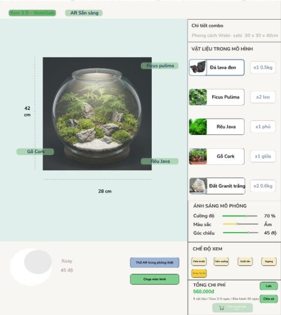
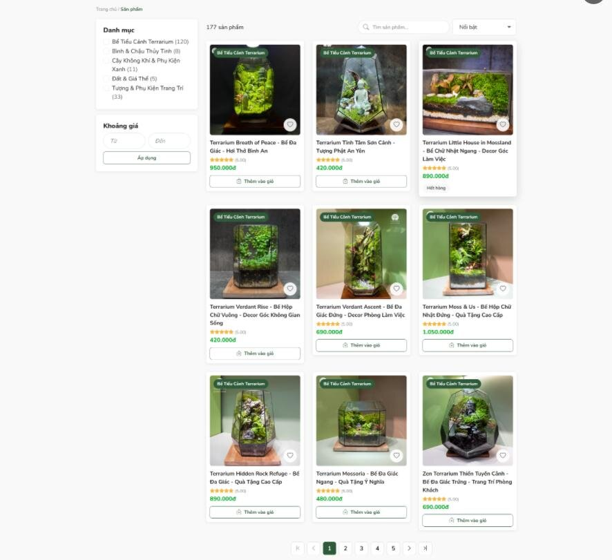
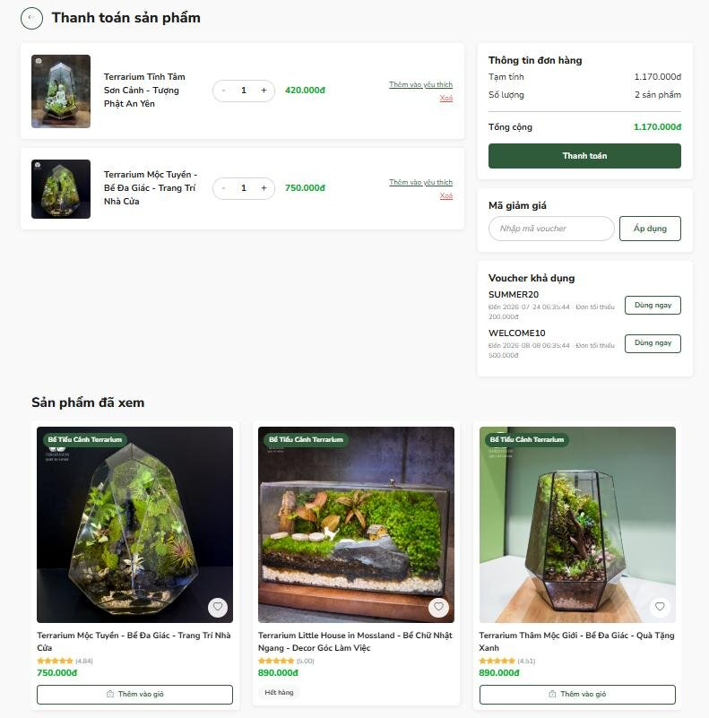
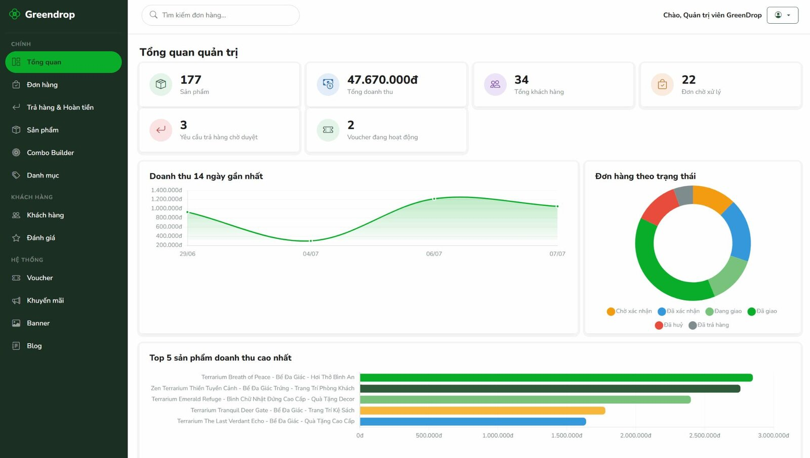
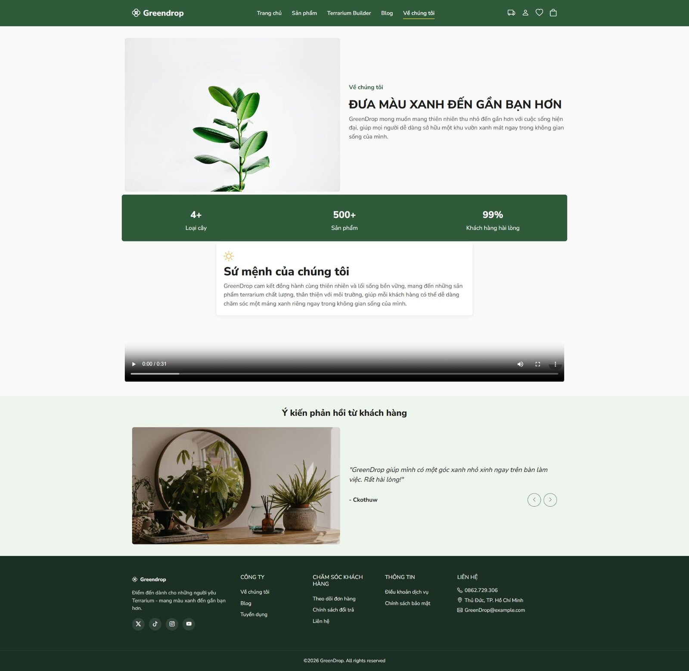
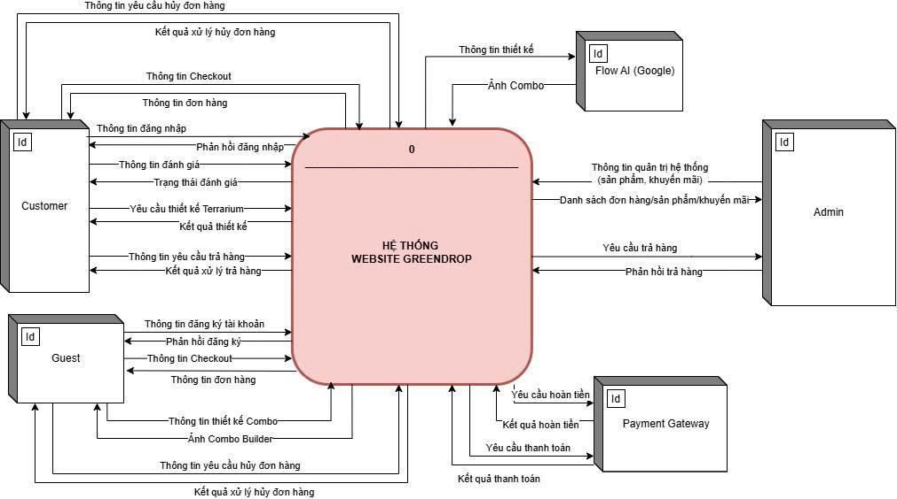
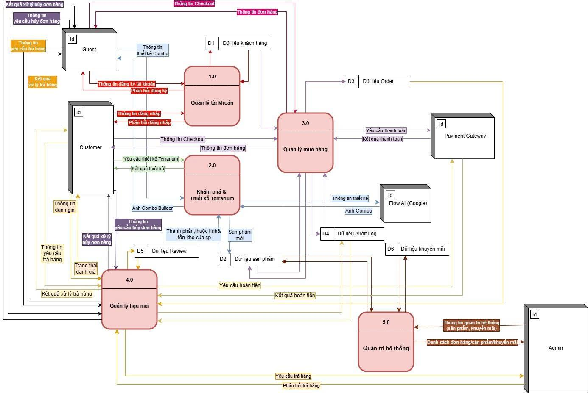
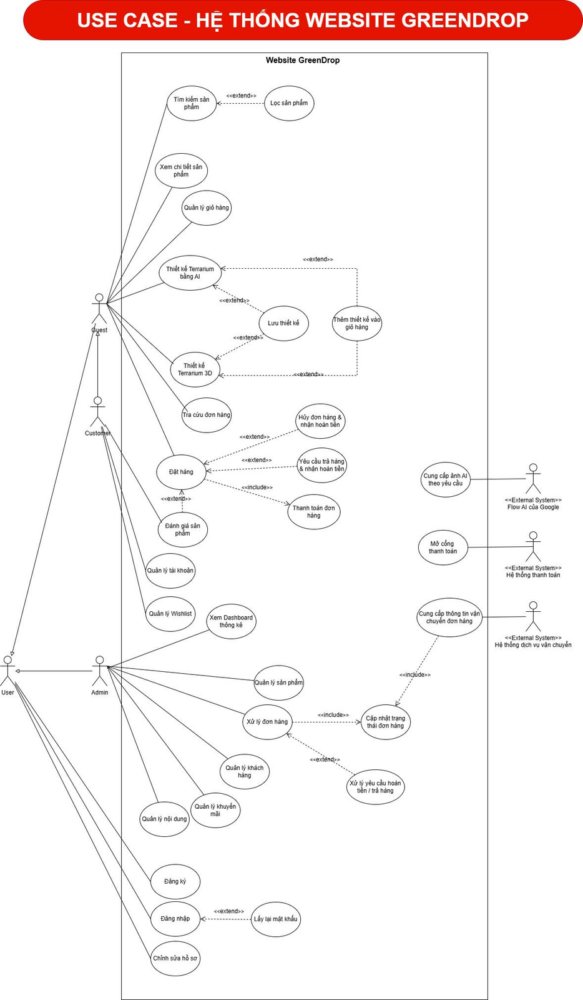
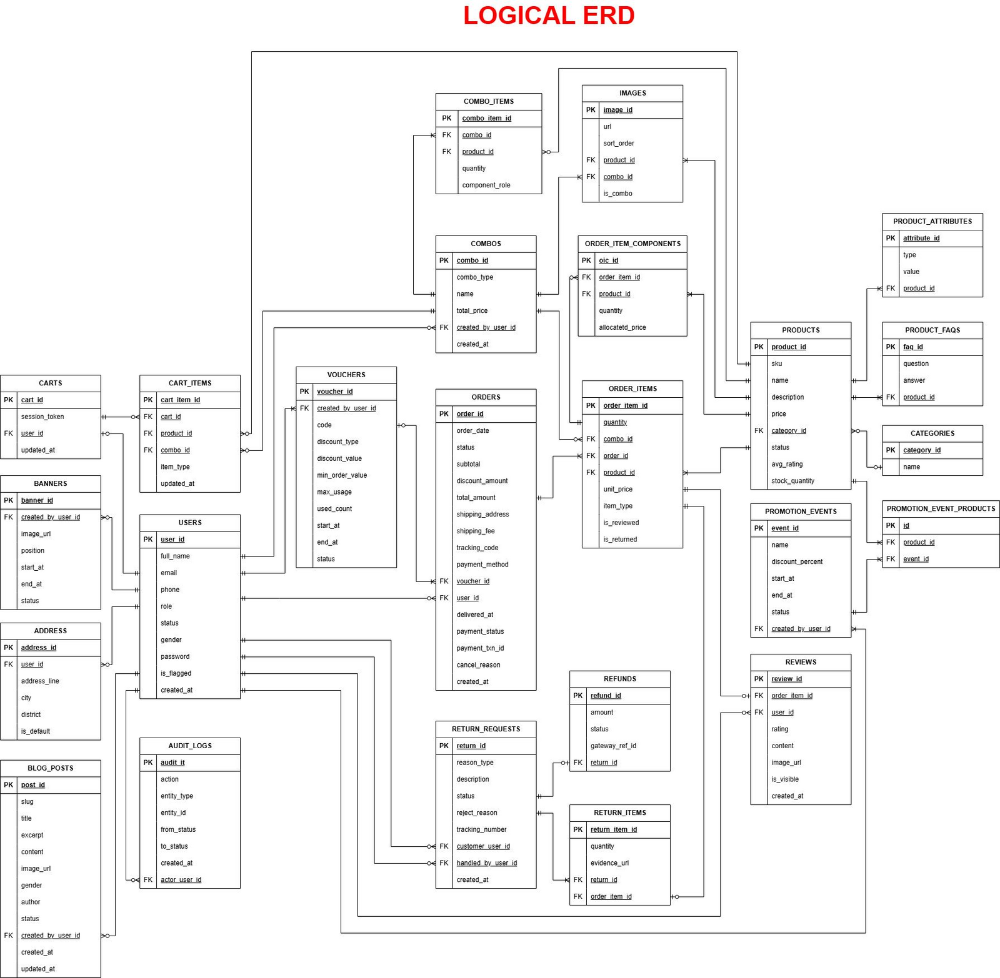

<div align="center">

# 🪴 GreenDrop

**An e-commerce website for terrariums and mini plants, with an AI-powered custom Terrarium Builder.**

*Course project: Business Web Development, University of Economics and Law (VNU-HCM), Apr – Jul 2026*


[🇻🇳 Tiếng Việt](docs/README.vi.md) · [📄 Full project report (VI)](docs/GreenDrop_Project_Report_VI.pdf) · [🧪 Postman collection](docs/postman/GreenDrop.postman_collection.json)



</div>

---

## 📌 The problem

Terrarium shops in Vietnam mostly sell **pre-designed products only**. Customers who want a personalised terrarium have to message the shop back and forth, cannot see the result before buying, and have little visibility over orders, cancellations or returns.

**GreenDrop** addresses this with:

- **Custom Combo Builder.** Customers choose a container, substrate, plants and decorations, and an **AI image preview** (SDXL) shows the finished terrarium before checkout.
- **A complete post-purchase flow.** Order tracking, cancellation with automatic refund, returns with photo evidence, and verified reviews.
- **A separate admin portal.** Products, combos, orders, returns and refunds, vouchers, promotions, banners, blog, and a revenue dashboard.

## 🖼️ Screenshots

| Product catalog | Cart & checkout |
|---|---|
|  |  |
| **Admin dashboard** | **About page** |
|  |  |

## 📐 Business analysis

The project followed a standard analysis-to-build flow: the business requirements and diagrams below were agreed before development and then traced to the database and the API.

| Artifact | Scope |
|---|---|
| Actors & permissions | **3 roles** (Guest, Customer, Admin) + external actors (payment gateway, shipping provider, email/SMS) |
| Requirements | **16 business requirements** (BR-C01–C08, BR-A01–A08), **32 functional requirements** (FR-01–FR-32), **13 non-functional requirements** |
| Process models | **7 BPMN processes**, each with business rules and exception scenarios |
| Data flow | Context DFD + Level-0 DFD with data-store descriptions |
| Use cases | Overview diagram + **7 detailed use case specifications** |
| Data model | Conceptual & logical ERD, **24 entities**, implemented as 24 MySQL tables / 34 foreign keys |

<details>
<summary><b>7 BPMN processes</b> (click to expand)</summary>

| # | Process | Diagram |
|---|---|---|
| 1 | Browse & purchase ready-made products | [view](docs/diagrams/bpmn-1-browse-and-purchase.png) |
| 2 | Purchase through the Custom Combo Builder | [view](docs/diagrams/bpmn-2-custom-combo-builder.png) |
| 3 | Order cancellation & refund | [view](docs/diagrams/bpmn-3-cancel-and-refund.png) |
| 4 | Return & refund | [view](docs/diagrams/bpmn-4-return-and-refund.png) |
| 5 | Product review (Guest & Customer) | [view](docs/diagrams/bpmn-5-product-review.png) |
| 6 | Product management (CRUD, pricing, attributes) | [view](docs/diagrams/bpmn-6-product-management.png) |
| 7 | Promotion management | [view](docs/diagrams/bpmn-7-promotion-management.png) |

</details>

<details>
<summary><b>DFD, Use case, ERD, Sitemap</b> (click to expand)</summary>

| Context DFD | Level-0 DFD |
|---|---|
|  |  |
| **Use case overview** | **Logical ERD (24 entities)** |
|  |  |

Also available: [Conceptual ERD](docs/diagrams/erd-conceptual.png) · [Sitemap](docs/diagrams/sitemap.png)

</details>

### Key business rules (examples)

- A custom combo must contain **at least one container and one substrate** before it can be saved or added to the cart; Builder items carry an assembly fee.
- Customers can cancel only while the order is **"preparing"**. Online payments are refunded automatically; a failed refund falls back to manual handling by an admin.
- Returns must be filed **within 48 hours** (shipping damage) or **7 days** (hidden defects), with at least one photo. Accounts with **more than 3 returns in 180 days** are flagged for manual review.
- Only buyers of **delivered** orders can review, once per order, with basic spam and profanity screening.
- At most **one voucher per order**; the online-payment QR code expires after **15 minutes**.

## 🏗️ Architecture

```
┌──────────────┐   ┌──────────────┐
│  client/     │   │  admin/      │   AngularJS 1.x + Bootstrap 5
│  storefront  │   │  back-office │   (two independent apps)
│  :8080       │   │  :8081       │
└──────┬───────┘   └──────┬───────┘
       │   REST + JWT     │
       ▼                  ▼
┌──────────────────────────────────┐
│  backend/  Node.js + Express     │   Routes → Controllers → Services
│  :4000     89 REST endpoints     │   JWT auth, multer uploads
└──────┬───────────────────┬───────┘
       │                   │
       ▼                   ▼
┌──────────────┐   ┌──────────────────┐
│  MySQL 8     │   │ Pixazo SDXL API  │  AI preview (optional,
│  24 tables   │   │                  │  placeholder if no key)
└──────────────┘   └──────────────────┘
```

### API overview: 89 endpoints in 10 modules

| Module | Endpoints | Main responsibilities |
|---|:-:|---|
| Auth | 7 | Register, log in, current user, forgot/verify/reset password, change password |
| Users & addresses | 8 | Profile, address book; admin user list and account status |
| Catalog | 9 | Products (search, filter, sort, paging) and categories; admin CRUD |
| Content | 15 | Blog, banners, image uploads |
| Combo Builder (AI) | 8 | Save, update and list designs; `POST /api/combos/ai-preview` |
| Cart & promotions | 15 | Cart for guests and customers, voucher check, promotion events |
| Orders & payment | 10 | Checkout, tracking, payment confirmation, status updates, cancellation |
| Returns & refunds | 10 | Return requests with evidence, approve/reject, item received, refund retry |
| Reviews | 5 | Verified reviews, admin moderation |
| Admin & audit | 2 | Dashboard statistics, audit log |

The full list, ready to run, is in the **[Postman collection](docs/postman/GreenDrop.postman_collection.json)**. Import it, run `01 Auth > POST /api/auth/login` (the token is stored automatically), then run any folder with the Collection Runner. Every request includes smoke tests (no 5xx response, response time under 2 s).

## 🚀 Getting started

**Requirements:** Docker, Node.js 18+

```bash
git clone https://github.com/thienAG4/GreenDrop.git
cd GreenDrop

# 1. Configure secrets
cp .env.example .env
# then set JWT_SECRET in .env, e.g. the output of: openssl rand -hex 32

# 2. Start MySQL + API (schema and seed data load on first run)
docker compose up -d --build
curl http://localhost:4000/api/health      # {"data":{"status":"ok"}}

# 3. Storefront (http://localhost:8080)
cd client && npm install && npm start

# 4. Admin portal (http://localhost:8081), in another terminal
cd admin && npm install && npm start
```

**Demo accounts** (password `greendrop123`): admin `admin@greendrop.com`, staff `lily@greendrop.com`, customer `alice@example.com`.

To reset the database: `docker compose down -v && docker compose up -d --build`.

Manual setup without Docker, environment variables and the schema notes are documented in the [Vietnamese README](docs/README.vi.md).

## 📁 Project structure

```
GreenDrop/
├── backend/              Express API: routes/ controllers/ services/ middleware/
│   ├── create_database.sql   schema: 24 tables, 34 FKs
│   └── init.sql              seed data
├── client/               Storefront (AngularJS, ngRoute)
├── admin/                Admin portal (separate AngularJS app)
├── docs/
│   ├── diagrams/         BPMN ×7, DFD, use case, ERD, sitemap
│   ├── screenshots/
│   ├── postman/          API test collection (89 requests)
│   ├── GreenDrop_Project_Report_VI.pdf
│   └── README.vi.md
├── docker-compose.yml
└── .env.example
```

## ⚠️ Scope & known limitations

This is an academic project. The following parts are **simulated** or **out of scope**:

- Payment gateways (MoMo, VNPay, QR) and email/SMS are mocked; password-reset codes are printed to the backend log.
- The "3D Terrarium Studio" is a 2D drag-and-drop canvas, not real 3D rendering.
- AI review moderation, a chatbot, product recommendations and BI dashboards are documented as future work.
- Not deployed to production.

## 👥 Team

| Member | Role |
|---|---|
| Nguyễn Tấn Trọng | Project Lead & Team Coordinator |
| **Nguyễn Đức Thiện** ([@thienAG4](https://github.com/thienAG4)) | **Business Analysis Lead**: requirements (BR/FR/NFR), BPMN, DFD, use case specifications, ERD review, manual end-to-end testing |
| Đỗ Hải Thuận | UI/UX & Figma Lead |
| Mai Thế Thư | Full-stack Development Lead |
| Lê Quang Huy | Database Design Lead |

Originally developed at [CkoThuw11/GreenDrop](https://github.com/CkoThuw11/GreenDrop).
